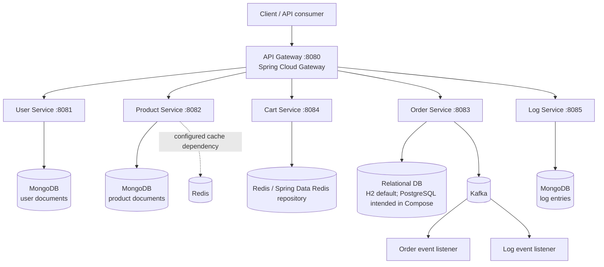

# E-Commerce Microservices Platform

A Java/Spring Boot e-commerce backend organized into independently deployable services for user accounts, product catalog, shopping carts, orders, and application logs. An API Gateway provides a single HTTP entry point and applies a JWT-oriented authentication filter before forwarding requests to downstream services. Kafka is used for event-driven order/log processing, MongoDB stores document-oriented data, Redis is configured for cart/cache use, and the order service uses Spring Data JPA.

> **Implementation status:** This README was prepared by inspecting the supplied source archive. It documents the code and configuration found there; it does not claim that every service currently starts successfully or that the system has been load-tested. See [Known gaps and validation notes](#known-gaps-and-validation-notes) before treating this as a production deployment guide.

## Contents

- [Architecture](#architecture)
- [Services](#services)
- [Technology stack](#technology-stack)
- [Request and event flows](#request-and-event-flows)
- [API reference](#api-reference)
- [Data stores](#data-stores)
- [Configuration](#configuration)
- [Run locally](#run-locally)
- [Build and test](#build-and-test)
- [Observability](#observability)
- [Security notes](#security-notes)
- [Known gaps and validation notes](#known-gaps-and-validation-notes)
- [Scaling and performance validation](#scaling-and-performance-validation)

## Architecture



The diagram represents the intended service topology inferred from the source and Compose files. The supplied root Compose file defines infrastructure containers only; it does **not** start all six Java services. Individual service Compose files exist, but their configurations are not yet unified into a single verified deployment.

### Repository layout

```text
micro_services/
├── api-gateway/       # Gateway routes, JWT filter, security configuration
├── user-service/      # Registration, login, profile, password change
├── product-service/   # Product CRUD
├── cart-service/      # User cart operations
├── order-service/     # Order CRUD/status and Kafka order events
├── log-service/       # Log queries and Kafka log consumer
├── docker-compose.yml # Shared infrastructure containers
└── pom.xml            # Maven parent with service modules
```

## Services

| Service | Default port | Responsibility | Main persistence / integration |
|---|---:|---|---|
| API Gateway | `8080` | Routes external requests and applies `AuthenticationFilter` | Spring Cloud Gateway; forwards to ports `8081`–`8085` |
| User Service | `8081` | Register/login, retrieve profile, list users, change password | Spring Data MongoDB repository |
| Product Service | `8082` | Create, read, list, update, and delete products | Spring Data MongoDB repository; Redis/cache dependencies are declared |
| Order Service | `8083` in its app configuration | Create/read orders and update order status | Spring Data JPA; H2 is the application default, PostgreSQL is configured in its service Compose file; Kafka producer/consumer |
| Cart Service | `8084` | Read, add to, remove from, and clear a user's cart | Spring Data Redis repository abstraction |
| Log Service | `8085` | Query logs by service or return all logs; consume Kafka log events | Spring Data MongoDB and Kafka consumer |

## Technology stack

Versions below are those explicitly declared in the supplied manifests or container image tags. Transitive dependency versions may be determined by Spring Boot dependency management and are not exhaustively listed here.

| Technology | Declared version / configuration | Usage |
|---|---|---|
| Java | `21` in service POMs and Docker images | Runtime and compilation target |
| Spring Boot | `3.1.5` in individual service POMs; root parent declares `3.2.0` | Application framework |
| Spring Cloud | `2022.0.4` in gateway and order service POMs | Gateway and related cloud integrations |
| Spring Cloud Gateway | Version managed by Spring Cloud BOM | API routing and filters |
| Spring Web | Version managed by Spring Boot | REST endpoints in services |
| Spring Security | Version managed by Spring Boot | Security configuration |
| Spring Data MongoDB | Version managed by Spring Boot | User, product, and log repositories |
| Spring Data Redis | Version managed by Spring Boot | Cart repository and product-service dependency |
| Spring Data JPA / Hibernate | Version managed by Spring Boot | Order persistence |
| Apache Kafka / Spring for Apache Kafka | Kafka container `confluentinc/cp-kafka:7.3.0` in root Compose; service libraries managed by Spring Boot | Order events and log ingestion |
| MongoDB | `mongo:6.0` in Compose files | Document storage |
| Redis | `redis:7.0-alpine` in root and service Compose files | Cache/cart data integration |
| PostgreSQL | `postgres:15` in Compose | Relational database intended for order persistence; root Compose also defines a `userdb` database |
| H2 | Version managed by Spring Boot | In-memory default database for order service |
| JWT (JJWT) | `0.11.5` where explicitly declared | JWT-related code in gateway, user, and order services |
| Resilience4j circuit breaker integration | Version managed by Spring Cloud | Declared in order service dependencies |
| OpenFeign | Version managed by Spring Cloud | Declared in order service dependencies |
| Actuator | Version managed by Spring Boot | Health and management endpoints |
| Micrometer Prometheus registry | Version managed by Spring Boot | Prometheus metrics endpoint integration |
| Micrometer tracing OpenTelemetry bridge | Version managed by Spring Boot | Tracing instrumentation integration |
| Maven build image | `maven:3.9.4-eclipse-temurin-21` in service Dockerfiles | Containerized builds |
| Runtime image | `eclipse-temurin:21-jre-alpine` | Java service containers |
| Docker Compose format | `3.8` / `3.9` across files | Local infrastructure orchestration |

**Version note:** The repository has inconsistent Spring Boot parent versions: the root POM declares `3.2.0`, while the individual services declare `3.1.5`. The gateway and order service also import Spring Cloud `2022.0.4`. Align and verify these versions before relying on a root multi-module build.

## Request and event flows

### HTTP request flow

1. A client sends an HTTP request to the gateway on port `8080`.
2. The gateway matches the path against the route predicates in `api-gateway/src/main/resources/application.yml`.
3. The configured `AuthenticationFilter` runs for each listed route.
4. The gateway forwards the request to the configured downstream service.
5. The service controller invokes its service layer and repository, then returns an HTTP response.

Configured gateway routes:

| Route ID | Path predicate | Downstream URI |
|---|---|---|
| `user-service-route` | `/users/v1/**` | `http://localhost:8081` |
| `product-service-route` | `/products/v1/**` | `http://localhost:8082` |
| `order-service-route` | `/api/orders/**` | `http://localhost:8083` |
| `cart-service-route` | `/cart/v1/**` | `http://localhost:8084` |
| `log-service-route` | `/logs/v1/**` | `http://localhost:8085` |

These URIs are suitable only when the services are reachable at those addresses from the gateway process. In a container network, `localhost` refers to the gateway container itself; use Compose service DNS names and internal ports instead.

### Kafka event flow

- The order service defines a Kafka listener for topic `order-status-events` with consumer group `order-service-group`.
- The log service defines a Kafka listener for topic `application-logs` with consumer group `log-service-group`.
- The root Compose file declares a single Kafka broker and ZooKeeper. Its replication factor for the offsets topic is set to `1`, which is appropriate only for local development, not fault-tolerant production.
- The source archive does not establish that all log-producing paths publish to `application-logs`, nor that every order status change reliably publishes an event. Confirm the producer call sites and event payload format before relying on these flows.

## API reference

All paths below are relative to the service unless otherwise stated. The gateway is configured to route the same path prefixes. Authentication requirements can vary by route and are enforced by service security configuration as well as the gateway filter; verify the implementation and use a valid token for protected routes.

### User Service — `/users/v1`

| Method | Path | Purpose |
|---|---|---|
| `POST` | `/users/v1/register` | Register a user |
| `POST` | `/users/v1/login` | Authenticate a user and return an authentication response |
| `GET` | `/users/v1/profile` | Read the profile associated with `X-User-Id` |
| `GET` | `/users/v1/all` | List users |
| `PUT` | `/users/v1/change-password` | Change password |

### Product Service — `/products/v1`

| Method | Path | Purpose |
|---|---|---|
| `POST` | `/products/v1` | Create a product |
| `GET` | `/products/v1/{id}` | Get product by ID |
| `GET` | `/products/v1/all` | List products |
| `PUT` | `/products/v1/{id}` | Update a product |
| `DELETE` | `/products/v1/{id}` | Delete a product |

### Cart Service — `/cart/v1`

| Method | Path | Purpose |
|---|---|---|
| `GET` | `/cart/v1` | Read cart; expects `X-User-Id` |
| `POST` | `/cart/v1/add` | Add an item; inspect controller DTO/parameters for the exact request shape |
| `DELETE` | `/cart/v1/remove/{productId}` | Remove a product from cart |
| `DELETE` | `/cart/v1/clear` | Clear a user's cart |

### Order Service — `/api/orders`

| Method | Path | Purpose |
|---|---|---|
| `GET` | `/api/orders` | List orders |
| `GET` | `/api/orders/{id}` | Get an order by ID |
| `POST` | `/api/orders` | Create an order |
| `PUT` | `/api/orders/{id}/status` | Update order status |

### Log Service — `/logs/v1`

| Method | Path | Purpose |
|---|---|---|
| `GET` | `/logs/v1/all` | Return all logs |
| `GET` | `/logs/v1/service/{serviceName}` | Return logs for a service name |

### Example requests

Register/login and product/order payload fields depend on the DTO definitions. Use the DTO classes in each service as the authoritative request schema.

```bash
# Health endpoint example (if Actuator is enabled and reachable)
curl -i http://localhost:8080/actuator/health

# Product list via gateway; provide a valid token if required by the filter
curl -i http://localhost:8080/products/v1/all \
  -H 'Authorization: Bearer <JWT>'

# User profile; the service expects a user ID header
curl -i http://localhost:8080/users/v1/profile \
  -H 'Authorization: Bearer <JWT>' \
  -H 'X-User-Id: <USER_ID>'
```

The gateway's management endpoint configuration exposes `health` and `prometheus`, but the route configuration does not add a dedicated Actuator route. The first command therefore assumes the gateway's Actuator endpoint is directly accessible on the same port; confirm security and management exposure settings before using it.

## Data stores

| Service | Repository abstraction observed | Intended store / notes |
|---|---|---|
| User | `MongoRepository<User, String>` | MongoDB; service Compose file sets a Mongo URI |
| Product | `MongoRepository<Product, String>` | MongoDB; service Compose file sets a Mongo URI. Its `application.yml` also contains PostgreSQL/JPA-style settings that do not match the Mongo repository implementation and should be cleaned up. |
| Cart | `CrudRepository<Cart, String>` | Redis is declared as a dependency and configured in `application.yml`; verify the cart entity's Redis mapping and runtime connectivity. |
| Order | `JpaRepository<Order, Long>` | H2 in the default application configuration; PostgreSQL is injected through the order service Compose environment. |
| Log | `MongoRepository<LogEntry, String>` | MongoDB; the log service Compose file sets a Mongo URI. |

The root Compose file defines MongoDB credentials, Redis, Kafka/ZooKeeper, and PostgreSQL. It does not initialize separate databases for each service beyond the PostgreSQL database name shown in its environment. MongoDB database names are specified in the service-specific URIs.

## Configuration

Configuration is primarily in each service's `src/main/resources/application.yml` and its Docker Compose file. Environment variables are preferable to committing credentials or environment-specific hosts.

| Variable | Used by | Purpose / default in source |
|---|---|---|
| `SPRING_DATA_MONGODB_URI` | User, product, log Compose configurations | MongoDB connection URI set by service Compose files |
| `SPRING_KAFKA_BOOTSTRAP_SERVERS` | Order and log services | Kafka bootstrap servers; application default is `localhost:9092` |
| `SPRING_KAFKA_CONSUMER_GROUP_ID` | Order and log services | Kafka consumer group ID |
| `SPRING_DATASOURCE_URL` | Order service | JDBC URL; application default is in-memory H2 |
| `SPRING_DATASOURCE_DRIVER_CLASS_NAME` | Order service | JDBC driver; default H2 driver |
| `SPRING_DATASOURCE_USERNAME` | Order service | Database username; default `sa` |
| `SPRING_DATASOURCE_PASSWORD` | Order service | Database password; default empty |
| `SPRING_JPA_HIBERNATE_DDL_AUTO` | Order service | Hibernate DDL mode; default `update` |
| `REDIS_HOST` / `REDIS_PORT` / `REDIS_PASSWORD` | Cart service | Redis connection settings; defaults `localhost`, `6379`, and empty password |
| `SECURITY_JWT_SECRET` | Order service | JWT signing secret; source contains an unsafe development fallback |
| `SECURITY_JWT_EXPIRATION_MS` | Order service | JWT expiration; default `3600000` ms |

Some service configuration files currently use hard-coded credentials or secrets. Replace those values with environment variables or a secret manager before sharing or deploying the project. Do not publish real secrets in this README, `.env` files, issue trackers, or commit history.

## Run locally

### Prerequisites

- Java 21 JDK
- Maven 3.9+ (or a working Maven Wrapper in the relevant service directory)
- Docker Engine and Docker Compose plugin, if using containerized infrastructure
- Available local ports: `8080`–`8085`, `27017`–`27019`, `6379`–`6380`, `5432`, and Kafka/ZooKeeper ports as needed

### 1. Start shared infrastructure

From the repository root:

```bash
docker compose up -d mongodb redis zookeeper kafka postgres
```

This starts infrastructure only, not the Java applications. The root Compose file uses development credentials and a single Kafka broker. Do not expose this configuration to an untrusted network.

### 2. Build an individual service

For example:

```bash
cd user-service
./mvnw clean package
```

On Windows, use `mvnw.cmd`. Repeat for the other service directories. The service Dockerfiles build each service independently by copying only that service's `pom.xml` and `src` directory. The root Maven parent references service modules, but its configuration should be corrected and verified before using a root-level multi-module build.

### 3. Configure and start services

Start infrastructure first, configure each service's database and Kafka endpoints, then launch each Spring Boot service. Example:

```bash
# In each service directory, after dependencies/configuration are ready
./mvnw spring-boot:run
```

The gateway currently targets `localhost` service URLs. If the gateway is run in a container, update those routes to use service DNS names on a shared Docker network. The per-service Compose files each create their own local infrastructure containers and are not a unified deployment by themselves.

### 4. Verify health

Use the Actuator health endpoint on each service where it is enabled and accessible, for example:

```bash
curl -i http://localhost:8081/actuator/health
curl -i http://localhost:8082/actuator/health
curl -i http://localhost:8083/actuator/health
curl -i http://localhost:8084/actuator/health
curl -i http://localhost:8085/actuator/health
```

If an endpoint is denied or not found, check service security, Actuator exposure, and application startup logs. A successful HTTP response is not a substitute for checking database and Kafka connectivity.

## Build and test

Each service contains a Maven test source tree. The archive includes basic application-context tests and an order-service integration test. Run tests from each service directory:

```bash
./mvnw test
```

The Dockerfiles currently use `mvn clean package -DskipTests`, so container image builds do not execute tests. Run tests explicitly in CI before building release images. Test outcomes have **not** been verified as part of this README generation.

## Observability

Service configurations declare Spring Boot Actuator and Micrometer Prometheus registry dependencies, and expose `health` and `prometheus` management endpoints. They also set Micrometer tracing sampling probability to `1.0` and include the OpenTelemetry tracing bridge.

- Health: `/actuator/health`
- Prometheus metrics: `/actuator/prometheus`
- Metrics include an application tag derived from `spring.application.name`.

A tracing bridge alone does not establish that traces are exported to a collector or displayed in a tracing backend. No complete Prometheus, Grafana, or OpenTelemetry Collector deployment was verified in the supplied Compose configuration.

## Security notes

- The gateway contains a custom authentication filter and JWT utility. Review token validation, expiration checks, allowed algorithms, signing-key management, and error responses before production use.
- Several configuration files contain example secrets and plain-text database passwords. Treat these strictly as development placeholders and rotate them if any real credential was ever committed.
- The root Compose MongoDB password is a weak fixed development value, and Redis/Kafka are configured without production-grade authentication/TLS in the shown local setup.
- `X-User-Id` is used by user/cart endpoints. Downstream services must trust this header only when it is set or cryptographically protected by the gateway; direct access to service ports can allow spoofing unless prevented by network and service-level controls.
- Avoid exposing Actuator endpoints publicly. Apply authorization and network restrictions to management endpoints.
- Use HTTPS/TLS, least-privilege service credentials, input validation, secure password hashing, rate limiting, and audit logging for production deployments.

## Known gaps and validation notes

These issues were visible in the supplied source/configuration and should be addressed before describing the platform as production-ready:

1. **Inconsistent build parents:** the root POM declares Spring Boot `3.2.0`, while the six application POMs declare `3.1.5`. Gateway and order service use Spring Cloud BOM `2022.0.4`. Align the versions and validate compatibility.
2. **Root POM validity/build needs checking:** the root POM's XML namespace and schema-location values appear malformed compared with standard Maven POM declarations. Verify/fix the POM before relying on root-level builds.
3. **Gateway routes use localhost:** this will not work for downstream services inside separate containers. Use service DNS names on a shared network and correct internal ports.
4. **Order Docker port mismatch:** the order service application configuration declares port `8083`, while its Dockerfile exposes `8080` and its Compose file maps host `8083` to container `8080`. Align the application and container ports.
5. **Product persistence mismatch:** `ProductRepo` extends `MongoRepository`, but `application.yml` includes PostgreSQL datasource/JPA configuration. The service-specific Compose file instead supplies MongoDB. Remove stale configuration or intentionally implement one persistence model.
6. **User configuration nesting:** `user-service/application.yml` nests JWT, PostgreSQL, and JPA settings under `spring.application`, which does not match the expected Spring Boot property structure. Its Mongo repository also indicates MongoDB rather than PostgreSQL is the current persistence implementation.
7. **Kafka environment consistency:** root Compose uses Confluent Kafka `7.3.0`, while service-specific Compose files use Bitnami `latest`. Prefer a single pinned image/version and one shared Kafka cluster for integrated local development.
8. **Multiple Compose stacks conflict:** separate Compose files create distinct MongoDB, Redis, Kafka, and ZooKeeper instances, sometimes on overlapping host ports. Use one integrated Compose file for end-to-end runs.
9. **Development secrets:** replace hard-coded JWT secrets and passwords; do not use these defaults outside local development.
10. **Observability is partial:** metric/tracing libraries are declared, but a complete collector and monitoring stack were not found in the root Compose file.
11. **Load capacity is unmeasured:** the code and configuration do not establish a sustained capacity figure. No throughput, p95/p99 latency, error-rate, or saturation results are asserted here.
12. **Dependency and test status:** exact transitive dependency versions and successful test/build outcomes have not been established by this documentation pass.

## Scaling and performance validation

The target of one million requests per minute is approximately **16,667 requests per second** averaged across the minute. Whether this platform can sustain that rate depends on endpoint mix, database operations, cache hit rate, request/response sizes, authentication cost, Kafka throughput, network latency, and latency/error objectives.

A credible capacity claim should be based on repeatable load tests, not architecture diagrams or hardware estimates alone. Recommended next steps:

1. Fix the configuration and container networking issues listed above.
2. Define a workload mix for read, write, authentication, cart, and order endpoints.
3. Use k6 or an equivalent load generator from a separate machine or controlled runner.
4. Ramp traffic gradually and capture throughput, p50/p95/p99 latency, HTTP errors, CPU, heap/GC, database pool saturation, Redis latency, and Kafka consumer lag.
5. Test both steady-state traffic and bursts, including dependency failure and recovery.
6. Increase replicas and tune resources only after identifying the measured bottleneck.

Until those tests have been run and their results published, do not claim the project supports one million requests per minute. A useful follow-up deliverable would be a reproducible k6 test suite plus a results report.

---

## License

No license file was identified in the supplied archive. Add a license file if you want to grant others explicit permission to use, modify, or distribute this project.
